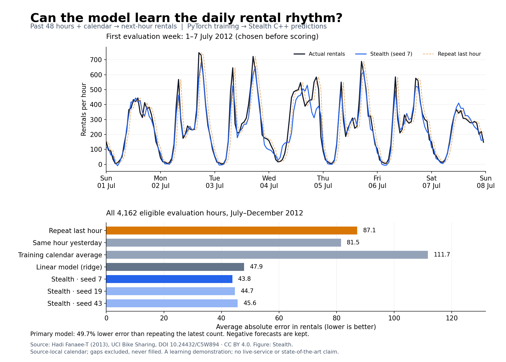

# A working example: forecast next-hour bike rentals

The model learned a useful pattern on this dataset. Across 4,162 eligible hours
in July–December 2012, the primary run's prediction missed by 43.82 rentals on
average. Repeating the last count missed by 87.15. The linear model missed by 47.90.
All three random starting points passed the frozen demonstration gate.



The top plot uses the first evaluation week, chosen before scoring. The blue
forecast often anticipates rises and falls while the orange "repeat last hour"
line lags behind. It still misses some peaks. This is one next-hour prediction at
a time, each using the latest observed history; it is not a seven-day forecast
made once at the beginning of the week.

For a concrete example, at 08:00 on Monday 2 July, the latest hour had 398 rentals.
The primary C++ model predicted about 463 for 08:00–09:00; the actual count was 568.
It anticipated part of the increase but underestimated its size. This example
illustrates the calculation; the full-period table below establishes the result.

## Results from the frozen run

Training used 6,595 eligible labels in 2011; validation used 3,904 in January–June 2012.
The model read 48 completed hourly counts plus known calendar information. It did
not receive future counts, weather, or the components of the target count.
All seeds ran eight epochs. Validation alone selected epochs 8, 6, 4 for seeds 7, 19, 43.
The selected ridge penalty was 0.01. No reruns or post-test tuning.

| Forecast | Average absolute error (MAE) | Large-error-sensitive score (RMSE) | Negative predictions |
|---|---:|---:|---:|
| Repeat latest count | 87.15 | 131.05 | 0 |
| Same hour yesterday | 81.53 | 135.52 | 0 |
| Training weekday/hour average | 111.73 | 157.48 | 0 |
| Linear model: ridge | 47.90 | 70.72 | 103 |
| Stealth seed 7, primary | 43.82 | 72.13 | 292 |
| Stealth seed 19 | 44.71 | 73.84 | 4 |
| Stealth seed 43 | 45.64 | 76.08 | 103 |

Both scores are in rental counts and lower is better. MAE measures the ordinary
size of a miss. RMSE gives big misses extra weight. The primary model lowers MAE
49.7% versus the latest-count baseline and 8.5% versus ridge. Ridge has the better
RMSE, so the transformer does not win under every definition of accuracy.

For the preregistered primary comparison, mean absolute-error difference versus
latest count is −43.32 rentals. The approximate 95% interval is [−46.88,−39.83],
using 2,000 resamples of 178 whole source-calendar days. Every seed beats latest
count by at least 10%, and that interval is below zero: the demonstration gate
passes. Longer seasonal dependence is outside this uncertainty calculation.
The ridge comparison is descriptive; no separate significance claim is made.

The primary model predicts a negative count in 292/4,162 hours (7.02%), reaching
−15.66. These impossible counts remain in the scores and plot; we did not clip
or round them after seeing the result. A count-aware output or loss is a useful
next design discussion. It requires a separately frozen experiment, as these
months have now been inspected. The simple calendar baseline also underpredicts
substantially; its observed bias is −96.55 rentals, versus −14.20 for the primary
model. This is a reminder that a historical average can become stale.

## What ran through C++

PyTorch trained the weights on CPU. Each selected model was exported as a 202,380-byte
artifact; Stealth's existing packed C++ inference kernel produced the evaluation
predictions. No C++ architecture or kernel changes were needed.

All 24,198 selected validation/evaluation latest predictions passed Torch/native
comparison. Both native kernels also passed 16 sampled full-window traces per
seed per split. The maximum observed discrepancy was 0.00015259 rentals under the
existing `5e-5 + 2e-4 * abs(reference)` tolerance. A fresh process reproduced the
entire evaluation ledger byte-for-byte, and all 67 sealed artifact hashes passed.

The new 11 component/integration tests cover calendar arithmetic, missing-hour
windows, training-only scaling, future-count perturbations, failure preservation,
real tiny training, native export, replay and tampering. All 79 offline tests and
101 training/reference tests pass locally; two optional Linux-only runtime tests
skip on this macOS host. Native source and packaging are unchanged. This run
establishes forecast functionality, not a new latency comparison.

To make a single forecast from the saved primary model without importing Torch,
run this in the existing native/NumPy environment from the repository root:

```python
import json, sys
from pathlib import Path
import numpy as np
import stealth_cpu
sys.path.insert(0, "tools")
import bike_demand as data

recipe = json.loads(Path("benchmarks/bike/demand_v1.json").read_text())
frame = data.parse_csv(Path("local/datasets/bike-v1/hour.csv").read_bytes(),
                       recipe["data"]["csv_sha256"])
when = data.hour("2012-07-02T08:00:00")
sample = data.split(frame, 48, when, when + 1)
model = stealth_cpu.ForecastModel.from_bytes(
    Path("local/bike-demand-v1/seed-7/model.stlf").read_bytes(), kernel="packed")
forecast = model.session().predict_last_batch(np.ascontiguousarray(sample.x))[0]
print(f"Predicted: {forecast:.1f}; actual: {sample.actual[0]:.0f} rentals")
```

This is an offline demonstration. It assumes the preceding completed hour's
count is immediately known. The source's timezone/DST and historical publication
delay are not established. Missing source hours exclude 2,165/464/254 candidate
labels in training/validation/evaluation respectively, including training warmup;
results apply to intact history stretches. The file has 165 missing hourly labels.
No financial transferability or best-in-class performance is claimed.

## Reproduce and inspect

- [Frozen protocol and commands](bike-demand-study-v1.md)
- [Machine-readable scores, all seeds and validation histories](evidence/bike-demand-v1/scores.json)
- [Aggregate verification record](evidence/bike-demand-v1/verification.json)
- Training code frozen before fitting: `086d9fdd59d6442bdbcb3e622237ca446b1df7a0`.
- Source and protocol hashes are bound into the run. Raw data, checkpoints,
  individual prediction ledgers and environment reports stay under ignored
  `local/`. The optional plotting command produces PNG, SVG and PDF.

Data: Hadi Fanaee-T (2013), [UCI Bike Sharing](https://archive.ics.uci.edu/dataset/275/bike+sharing+dataset),
DOI [10.24432/C5W894](https://doi.org/10.24432/C5W894),
[CC BY 4.0](https://creativecommons.org/licenses/by/4.0/).
The figure and aggregate results are derived from that source by Stealth.
