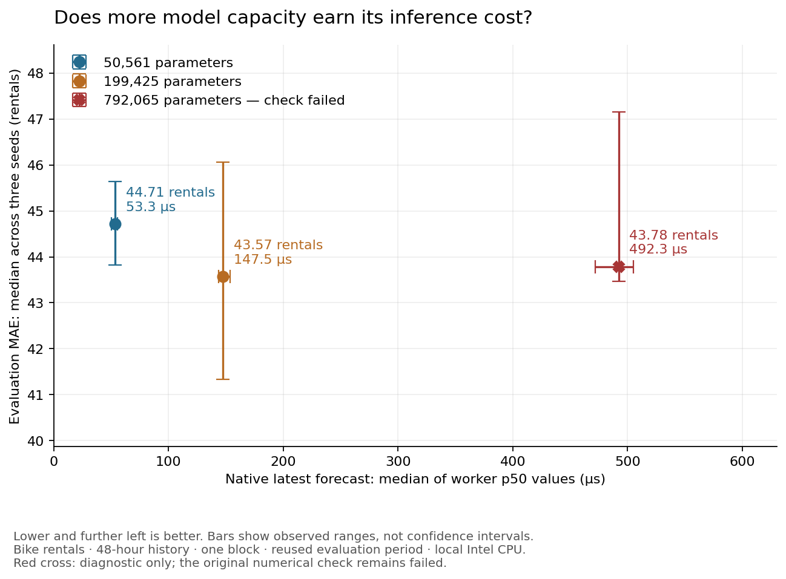

# Model size: small accuracy gains, much higher inference cost

Keep the 50.6k-parameter model as the efficient default for this task. Increasing
capacity to 199.4k parameters reduces median evaluation MAE by 2.56%, while
requiring 2.77 times the native inference time. The 792.1k family improves median
MAE by only 2.09% over the small family, costs 9.24 times as much inference time,
and fails the frozen numerical gate on one near-zero prediction. Its measurements
are diagnostic; it is not an accepted family under this protocol.

This is an exploratory comparison on the already inspected bike-rental evaluation
period. It does not establish a general best model size, fresh predictive evidence,
financial alpha or a speed advantage over other runtimes. No production default,
native kernel, model loss or tolerance was changed.



## What was held fixed

Nine fresh CPU fits: widths 64, 128 and 256, each with seeds 7, 19 and 43 and eight
epochs. Each sees the same 48 hourly observations and five count/calendar features,
uses one block and four heads, and predicts the following hour's rental count.
The MLP remains four times the model width. Every other data, training, checkpoint
selection and numerical setting comes from the original frozen bike study.

The [protocol and rationale](bike-size-study-v1.md) were committed before training
at `e2143542da2de8f9d0cd2002440dadd0ba2c7934`. The existing raw archive was reused;
no download or new dependency was needed. Source: Hadi Fanaee-T, UCI Bike Sharing
(2013), [DOI 10.24432/C5W894](https://doi.org/10.24432/C5W894), CC BY 4.0.

Each size uses 6,595 training, 3,904 validation and 4,162 evaluation windows. Fitted
scalers and simple baseline artifacts are byte-identical across all sizes. The
three 64-wide exports and their complete prediction ledger are also byte-identical
to the original study. This is a successful control for the rerun.

## Accuracy and cost

MAE is the average number of rentals missed; lower is better. RMSE penalizes large
misses more strongly. Accuracy columns below are medians of three per-model
scores, not an ensemble. Native p50/p99 columns are medians of nine worker
quantiles per size: three seeds × three trials, 1,000 calls each.

| Width | Trainable parameters | MAE | RMSE | Native p50 | Native p99 | Owned native buffers | Numerical gate |
| --- | ---: | ---: | ---: | ---: | ---: | ---: | --- |
| 64 | 50,561 | 44.71 | 73.84 | 53.302 µs | 87.299 µs | 0.340 MB | Pass |
| 128 | 199,425 | 43.57 | 72.78 | 147.513 µs | 206.283 µs | 1.071 MB | Pass |
| 256 | 792,065 | 43.78 | 71.69 | 492.298 µs | 819.824 µs | 3.715 MB | Fail; diagnostic only |

Each artifact additionally stores ten fitted scaler values. Native memory is the
measured sum of weights, fixed positions and one reusable workspace, in decimal
MB. It excludes caller arrays, object/allocator overhead, executable code and
process/runtime memory. Per-worker RSS measurements are retained separately.

Observed worker p50 ranges are 50.362–55.624, 143.798–153.784 and
471.788–504.987 µs. Corresponding p99 ranges are 54.273–105.366,
163.096–274.295 and 679.250–988.213 µs. These ranges and the chart's seed ranges
are observations, not confidence intervals or deadline guarantees.

All timings use one native thread on the local Intel Core i5-10600, macOS 14.8.7,
AppleClang 16 Release build. The executable's SHA-256 is
`8deb9a65f88ccec8dfff67ec07446d3fb9b586dfd8f7ea56566a513270c3bcd9`, identical to
the preceding accepted AVX audit. The 27 workers ran serially after training and
reference preparation, with rotating size order, 64 warmups, batch one and the
same first 32 eligible validation windows. No build, training or profiler ran
alongside them. Loading, Python conversion and feed handling are outside the timed
calls. There was no CPU affinity, frequency isolation or sustained-load test.

The earlier 97 µs ETTm1 result used 96 history steps and seven inputs. These bike
measurements use 48 steps and five inputs; the different numbers are not another
kernel optimization. Linux performance remains deferred.

## Every seed, including the weaker runs

| Width | Seed | Selected epoch | Evaluation MAE | Evaluation RMSE | Negative forecasts |
| --- | ---: | ---: | ---: | ---: | ---: |
| 64 | 7 | 8 | 43.8245 | 72.1264 | 292 |
| 64 | 19 | 6 | 44.7130 | 73.8425 | 4 |
| 64 | 43 | 4 | 45.6423 | 76.0782 | 103 |
| 128 | 7 | 8 | 43.5669 | 72.7819 | 36 |
| 128 | 19 | 3 | 41.3296 | 62.8660 | 45 |
| 128 | 43 | 7 | 46.0600 | 74.7264 | 0 |
| 256 | 7 | 8 | 47.1570 | 71.6922 | 175 |
| 256 | 19 | 6 | 43.4666 | 65.8692 | 14 |
| 256 | 43 | 8 | 43.7780 | 71.9228 | 15 |

Selection used validation MAE with the earliest epoch winning ties; the untrained
persistence candidate remained eligible. Every size received the same training
steps, not equal compute or separately tuned hyperparameters. Seed variation is
large relative to the median gain. The medium family does not consistently beat
the small family seed by seed.

The unchanged baselines have MAE/RMSE of 87.15/131.05 for the latest count,
81.53/135.52 for yesterday's same hour, 111.73/157.48 for the training calendar mean,
and 47.90/70.72 for ridge. Ridge still has lower RMSE than every family median,
although individual neural fits do better. Its latency was not compared here.
Negative forecasts were retained; there was no clipping or count-aware redesign.

## A real boundary finding, preserved as a failure

All nine selected models passed validation parity. During evaluation, width 256,
seed 7 failed on window 2,974, targeting source-calendar 2012-11-05 10:00:

| Computation | Forecast rentals |
| --- | ---: |
| Standard PyTorch, batch 32 or batch 1 | 0.046630971133708954 |
| Native scalar reference | 0.04672963544726372 |
| Native packed implementation | 0.04672963544726372 |
| PyTorch with only dense accumulation changed to native order | 0.04672963544726372 |

The absolute difference is 0.0000986643 rentals against an allowed 0.0000593262.
The diagnostic changes only dense operations to FP32 bias-first sequential
multiply/add, leaving the rest of the Torch graph intact. It exactly reproduces
both native outputs. This isolates the discrepancy to dense arithmetic ordering
for this window; it does not show an AVX-versus-scalar defect. The actual target
was 142 rentals, so the numerical discrepancy has negligible impact on forecasting
metrics, but that does not make the failed numerical contract a pass.

Across the nine models' validation and evaluation splits, 72,593 of 72,594 latest
comparisons satisfy the original tolerance. The sampled full traces pass for both
native kernels, including all three large models. The largest absolute evaluation
difference is 0.000610352 rentals; most such differences pass the relative part
of the tolerance. The one failing case is near zero, where the fixed absolute
allowance dominates.

The original parent and large-family run retain `failure.json` and have no
completion seal. The small and medium children retain their valid completion
seals. A separate postmortem checked the frozen selections against their saved
checkpoints, preserved every original file hash, computed all nine descriptive
outcomes and ran the timing grid. Its explicit status is diagnostic; it does not
repair or overwrite the original run. Fresh-process native replay reproduces all
37,458 evaluation predictions in the three ledgers byte for byte. Repeatability
and passing a cross-runtime tolerance remain separate checks.

Before accepting this large family, specify and independently test a numerical
error budget that covers differing FP32 matrix accumulation and near-zero outputs.
Keep this frozen failure visible. Changing the threshold on this inspected run
would not constitute a new validation result, and matching Torch's platform-specific
matrix implementation is not automatically a better arithmetic contract.

## Verification and artifacts

The final training/reference suite runs 117 tests: 114 pass and three optional
Linux tests skip. Seven sizing tests cover frozen recipes, independent parameter
counts, complete timing grids, invalid results, actual tiny training/export/replay
and native timing, tampering, and failures. The added late-failure regression proves
that earlier completed sizes and later saved checkpoints survive, while the parent
and failed child remain unsealed. No new native behavior was implemented.

The first remote ARM jobs were cancelled by GitHub's scheduled macOS 14 image
brownout, before executing project tests. The ARM job was migrated to the
supported `macos-15` image following the
[provider's migration notice](https://github.com/actions/runner-images/issues/13518).
The replacement CI run is separate from the local results above; it is not
claimed passed here.

[Evidence manifest](evidence/bike-size-v1/manifest.json),
[all accuracy results](evidence/bike-size-v1/training.json),
[latency summaries](evidence/bike-size-v1/latency.json),
[all raw worker times](evidence/bike-size-v1/raw-latency.json),
[rounding experiment](evidence/bike-size-v1/rounding-probe.json), and
[fresh-process replay](evidence/bike-size-v1/replay.json) retain the findings and
provenance. The one-off diagnostic sources are included alongside their recorded
hashes; run them with normal Python, without `-O`. Raw data, trained weights and
checkpoints remain in ignored `local/`.

Logged epoch durations total 289.465, 623.411 and 1,551.053 seconds for the three
families. These include validation and checkpoint I/O but exclude preparation,
post-selection parity and evaluation. The failed parent did not seal its intended
total-study wall-time summaries; those are unavailable. The epoch logs are retained
as diagnostics, not presented as a clean training-throughput benchmark.

The plot can be regenerated using an environment with the already optional
Matplotlib dependency:

```sh
MPLCONFIGDIR=local/matplotlib-cache python3 tools/plot_bike_size.py \
  --evidence docs/evidence/bike-size-v1 \
  --output local/bike-size-plot
```
